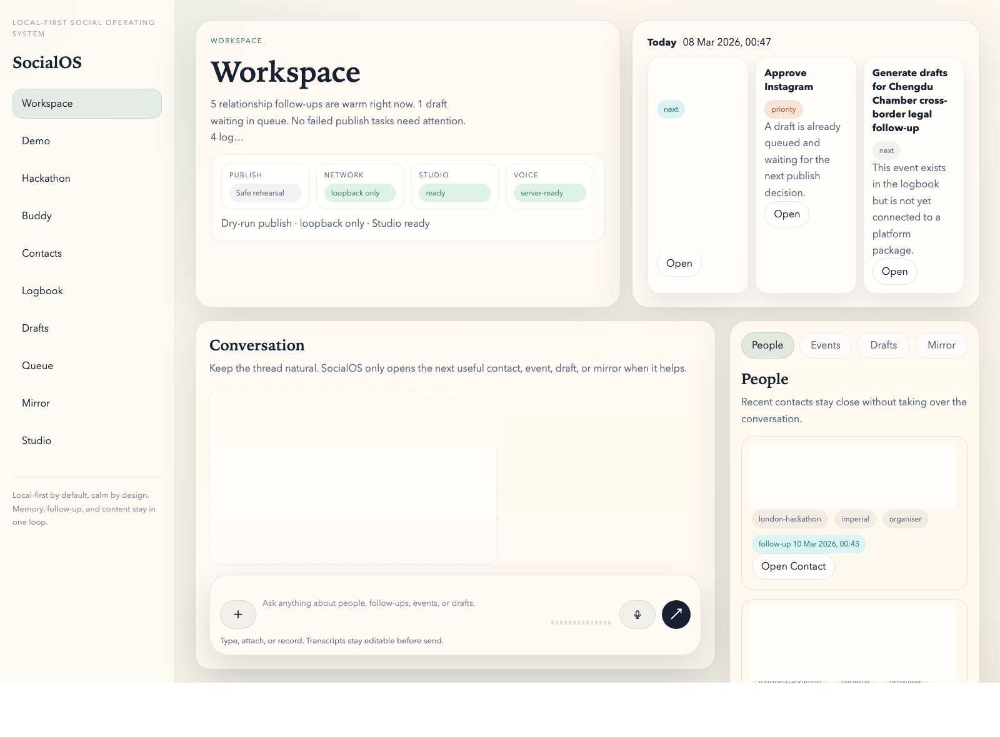

# SocialOS

SocialOS turns raw notes, voice memos, screenshots and encounters into structured memory about people and events, reflections grounded in that memory, and drafts for each platform. Nothing is published until a person approves it in the queue. It runs on your own machine (a local web app, a local API and a SQLite database) and works without any API keys; model providers are optional.

It was built for the UK AI Agent Hack EP4 (Imperial College London, opened 1 March 2026); the build itself took five days, 5–9 March, and the project was entered in five DoraHacks bounty tracks. The whole build is in the history: 1,222 commits between 5 and 9 March 2026, 1,084 of them tagged `[autodev]` — commits made by the automated coding agents set up for that week. Development stopped on 9 March 2026; later commits add a licence, repair the public site, and tidy the README and archive notes. No feature work since. Read it as a working hackathon prototype, not a maintained product; issues and pull requests are not monitored.

By Xiaoxiao Zhouyi · [zhouyixiaoxiao.com](https://zhouyixiaoxiao.com/)



*The Workspace with seeded demo data; personal names and remarks are redacted in this public preview: one note in, people memory and platform drafts out; nothing is posted until you approve it.*

## See it

The public site keeps the entry's content unchanged, with its links repaired:

- [Pitch deck](https://zhouyi-xiaoxiao.github.io/openclaw-foundry-socialos/)
- [Bounty hub](https://zhouyi-xiaoxiao.github.io/openclaw-foundry-socialos/hackathon/): one section per track, with its integration and proof JSON
- Demo videos, one per track: [Claw for Human (relationship workspace)](https://zhouyi-xiaoxiao.github.io/openclaw-foundry-socialos/videos/claw-for-human/) · [Human for Claw (safe social tasks)](https://zhouyi-xiaoxiao.github.io/openclaw-foundry-socialos/videos/human-for-claw/) · [Z.AI General](https://zhouyi-xiaoxiao.github.io/openclaw-foundry-socialos/videos/z-ai-general/) · [AI Agents for Good](https://zhouyi-xiaoxiao.github.io/openclaw-foundry-socialos/videos/ai-agents-for-good/) · [Animoca](https://zhouyi-xiaoxiao.github.io/openclaw-foundry-socialos/videos/animoca/)
- [Architecture](socialos/docs/ARCHITECTURE.md), [evidence](socialos/docs/EVIDENCE.md) and the [five-minute pitch](socialos/docs/pitch/PITCH_5_MIN.md)

The site is read-only. The interactive product is not hosted anywhere; it runs locally, as below.

## Run it locally

```bash
git clone https://github.com/zhouyi-xiaoxiao/openclaw-foundry-socialos.git
cd openclaw-foundry-socialos
bash scripts/quickstart.sh
```

The default command starts the seeded demo. For a blank personal workspace, run:

```bash
bash scripts/quickstart.sh --profile local
```

Prerequisites: macOS or Linux, Node 22+, `sqlite3`, and `python3`.

### What runs without any API keys

- local web app
- local API
- seeded demo dataset
- local embeddings fallback
- core relationship-memory workflow

### What API keys unlock

- `OPENAI_API_KEY` -> better embeddings plus optional voice transcription/refinement
- `GLM_API_KEY` -> live Z.AI route and GLM (Z.AI's language model) generation
- `FLOCK_API_KEY` -> live FLock (a model provider) SDG (UN Sustainable Development Goals) triage
- `TELEGRAM_*` -> optional Telegram volunteer channel for multi-channel follow-through

Provider setup: [socialos/docs/API_SETUP.md](socialos/docs/API_SETUP.md).

## Project Overview

What the prototype does:

- remembers people and the events you met them at, and links the same person across platforms
- drafts a follow-up post or message in each platform's style
- holds every draft in a queue until you approve it
- writes a weekly reflection that cites the notes it came from

## Architecture Overview

Core system shape:

- Frontend: local web app in `socialos/apps/web`
- API: local service in `socialos/apps/api`
- Database: profile-managed SQLite under `infra/db/`
- Runtime: OpenClaw (the product runtime coordinating memory, safety checks, publishing, and reflection) in `socialos/openclaw/runtime.openclaw.json5`
- Control plane: Studio task, run, agent, and policy layer in SQLite and `foundry/`

System design:

1. A user sends one raw note, voice memo, or image into `Workspace`.
2. The API extracts reusable people memory, event context, and your own check-ins.
3. The same memory powers `Contacts`, `Logbook`, and search that can find related notes even when wording differs.
4. Events flow into multilingual, platform-native draft generation.
5. Drafts move through validation and a queue until you approve them.
6. `Self Mirror` closes the loop with a weekly reflection that cites the notes it came from.

Hackathon overlay:

- `/demo` is the shared product walkthrough and `Claw for Human` route.
- `/hackathon` is the canonical bounty hub and proof matrix.
- `/buddy` is the `Human for Claw` safe-mode route.
- `GET /hackathon/overview` returns bounty metadata used by the hub.
- `GET /proofs` returns structured proof cards.
- `POST /integrations/glm/generate` captures the live `Z.AI General` proof path.
- `POST /integrations/flock/sdg-triage` captures the live `AI Agents for Good` proof path.
- `GET /integrations/telegram/status` and `POST /integrations/telegram/send` expose the optional Telegram volunteer channel used by the impact workflow.

## Bounty-Specific Integration

SocialOS was entered in five tracks with one product story:

| Bounty | What it shows | Video | Proof JSON |
| --- | --- | --- | --- |
| `Claw for Human` | A calm, human-readable relationship workspace | [Watch](https://zhouyi-xiaoxiao.github.io/openclaw-foundry-socialos/videos/claw-for-human/) | [`claw-for-human.json`](https://zhouyi-xiaoxiao.github.io/openclaw-foundry-socialos/data/proofs/claw-for-human.json) |
| `Animoca Bounty` | Persistent identity and memory across sessions | [Watch](https://zhouyi-xiaoxiao.github.io/openclaw-foundry-socialos/videos/animoca/) | [`animoca.json`](https://zhouyi-xiaoxiao.github.io/openclaw-foundry-socialos/data/proofs/animoca.json) |
| `Human for Claw` | Four safe, youth-friendly social tasks | [Watch](https://zhouyi-xiaoxiao.github.io/openclaw-foundry-socialos/videos/human-for-claw/) | [`human-for-claw.json`](https://zhouyi-xiaoxiao.github.io/openclaw-foundry-socialos/data/proofs/human-for-claw.json) |
| `Z.AI General` | GLM-backed platform draft generation | [Watch](https://zhouyi-xiaoxiao.github.io/openclaw-foundry-socialos/videos/z-ai-general/) | [`z-ai-general.json`](https://zhouyi-xiaoxiao.github.io/openclaw-foundry-socialos/data/proofs/z-ai-general.json) |
| `AI Agents for Good` | FLock SDG triage and Telegram follow-through | [Watch](https://zhouyi-xiaoxiao.github.io/openclaw-foundry-socialos/videos/ai-agents-for-good/) | [`ai-agents-for-good.json`](https://zhouyi-xiaoxiao.github.io/openclaw-foundry-socialos/data/proofs/ai-agents-for-good.json) |

High-level fit:

- `Claw for Human`: SocialOS turns the OpenClaw runtime into a calm, human-readable relationship workspace.
- `Animoca Bounty`: SocialOS keeps identity and memory across sessions and coordinates several agents, rather than running one-shot tasks.
- `Human for Claw`: Buddy mode narrows the system to four safe, youth-friendly social tasks.
- `Z.AI General`: when `GLM_API_KEY` is set, GLM generates the platform drafts in the main draft path.
- `AI Agents for Good`: FLock's SDG triage, the OpenClaw runtime, and Telegram-powered follow-through feed directly into relationship memory.

Full submission source text lives in [socialos/docs/HACKATHON_BOUNTIES.md](socialos/docs/HACKATHON_BOUNTIES.md).

Hackathon materials: [socialos/docs/pitch/](socialos/docs/pitch/).

## Troubleshooting

- `sqlite3 is required`: install SQLite and rerun the quickstart command
- `Node 22 or newer is required`: upgrade Node and rerun the quickstart command
- `stale demo process`: run `bash scripts/stop_demo.sh`, then rerun quickstart
- `seed/reset confusion`: demo and local profiles use different DB files; switch profile instead of reusing the same database

Status and test commands, and the archived hackathon preflight and proof-capture commands, are in [socialos/docs/AGENT_PLAYBOOK.md](socialos/docs/AGENT_PLAYBOOK.md).

## Safety Defaults

- API exposure remains loopback-only (`127.0.0.1`)
- default publish mode remains `dry-run`
- live publish still requires explicit credentials and user intent
- do **not** widen `gateway.bind`, `gateway.tailscale`, or `gateway.auth`

## Public Docs

- [socialos/docs/PRODUCT.md](socialos/docs/PRODUCT.md)
- [socialos/docs/ARCHITECTURE.md](socialos/docs/ARCHITECTURE.md)
- [socialos/docs/DEMO_SCRIPT.md](socialos/docs/DEMO_SCRIPT.md)
- [socialos/docs/SAFETY.md](socialos/docs/SAFETY.md)
- [socialos/docs/EMBEDDINGS.md](socialos/docs/EMBEDDINGS.md)
- [socialos/docs/AGENT_PLAYBOOK.md](socialos/docs/AGENT_PLAYBOOK.md)
- [socialos/docs/EVIDENCE.md](socialos/docs/EVIDENCE.md)
- [socialos/docs/SYSTEM_MANIFEST.json](socialos/docs/SYSTEM_MANIFEST.json)
- [socialos/docs/DOCS_INDEX.md](socialos/docs/DOCS_INDEX.md)
